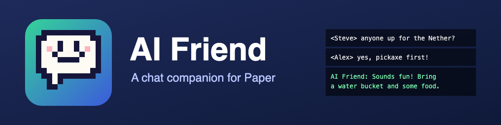

# AI Friend Wiki

**A friendly AI chat companion for Paper servers.**

AI Friend reads the public chat of your server and posts short replies as a bot with your own name, language and personality. The answers come from the AI provider **you** choose: OpenAI, Anthropic Claude, a local Ollama model or any OpenAI-compatible server (OpenRouter, LM Studio, vLLM, ...). Nothing goes through the plugin author; the plugin has no server of its own.

| | |
| :--- | :--- |
| **Platform** | Paper `26.3` or newer (Folia-compatible schedulers) |
| **Java** | 25 |
| **Current version** | 3.1.1 |
| **License** | MIT |
| **Downloads** | [Modrinth](https://modrinth.com/plugin/aifriend) · [Hangar](https://hangar.papermc.io/filasik/AIFriend-Personal_Assistant) · [GitHub Releases](https://github.com/filasik/ai-friend/releases) |
| **Source / issues** | [github.com/filasik/ai-friend](https://github.com/filasik/ai-friend) |

> **Privacy first.** Chat lines, including player names, are sent to the AI provider you configure, and to nobody else. Read [Privacy and Data](Privacy-and-Data) before you enable the bot on a public server.

## Where to start

| I want to... | Read |
| :--- | :--- |
| Install the plugin | [Installation](Installation) |
| Connect OpenAI, Claude, Ollama or OpenRouter | [Provider Setup](Provider-Setup) |
| Understand every option in `config.yml` | [Configuration](Configuration) |
| See every command and permission | [Commands and Permissions](Commands-and-Permissions) |
| Turn on personas, `/ai`, limits, the reply filter, events | [Chat Features](Chat-Features) |
| Let the bot remember players across restarts | [Long-Term Memory](Long-Term-Memory) |
| Teach the bot about my server (rules, IP, shops) | [Server Knowledge](Server-Knowledge) |
| Give the bot a mood, relationships and world awareness | [World Awareness and Personality](World-Awareness-and-Personality) |
| Use SQLite or MariaDB | [Storage and Database](Storage-and-Database) |
| Translate or restyle the messages | [Messages and Localization](Messages-and-Localization) |
| Know exactly what leaves my server | [Privacy and Data](Privacy-and-Data) |
| Hook into the bot from my own plugin, or use placeholders | [Developer API and Placeholders](Developer-API-and-Placeholders) |
| Update from an older version | [Upgrading](Upgrading) |
| Fix a silent bot or an error in the log | [Troubleshooting](Troubleshooting) and [FAQ](FAQ) |
| Build the plugin or contribute | [Building and Contributing](Building-and-Contributing) |

## Highlights

- **Chat companion.** Collects what players write and answers with one short message per interval, as `<chatbot-name>: <reply>`. It does not answer every time: it stays quiet when players talk among themselves and joins in when spoken to.
- **Your choice of AI.** OpenAI (default), Anthropic Claude, Ollama or any OpenAI-compatible endpoint, with a failover chain and an optional answer cache.
- **Fits the chat.** It picks up the tone and slang of the recent chat, and `chattiness` decides how eagerly it joins conversations.
- **Chat intelligence, all off by default.** Personas, conversation memory, rate and daily limits, a cost estimate, a reply filter, direct questions (`/ai`, `@Name`), per-player mute and reactions to game events.
- **Long-term memory.** Remembers what players told it about themselves (SQLite or MariaDB); players list and delete their notes.
- **Server knowledge.** Answers from your `knowledge.txt`, facts added in game, and a built-in self-description. Optionally learns server facts from the chat, after an admin approves them in a GUI.
- **World awareness and personality.** Time, weather and nearby mobs, a mood, relationships with nicknames, conversation starters in a quiet chat and friendly chat supervision.
- **Integrations.** `AiFriendResponseEvent`, the `AiFriendApi` service and PlaceholderAPI placeholders such as `%aifriend_mood%`.
- **Never blocks the server.** Network calls are asynchronous with timeouts; failures back off exponentially (1, 2, 4, ... up to 15 minutes).
- **Low maintenance.** A commented `config.yml` that is never overwritten and gains new options on update, editable English and Czech messages, update notices from GitHub.

## How it works in 30 seconds

1. Every public chat line goes into a bounded queue (`max-queued-messages`). Lines of muted players are skipped.
2. Every `interval-seconds` the queued lines are sent as one batch to your provider: the rules and persona as the system message, the chat lines as clearly delimited data.
3. The model answers with a reply or decides to stay quiet. The reply passes the reply filter and is posted as `<chatbot-name>: <reply>`.
4. If the request fails, the batch is kept and retried after a backoff. With a failover chain the next provider is tried first.

Players can also talk to the bot directly (`/ai <question>`, `@AI Friend ...`), which answers at once. See [Chat Features](Chat-Features).

## Authors and support

- Filasik (Discord: `filasik`)
- Patr1xCZ (Discord: `paprik_man`)

Bugs and ideas go to [GitHub issues](https://github.com/filasik/ai-friend/issues). Website: [minebook.eu](https://minebook.eu).
